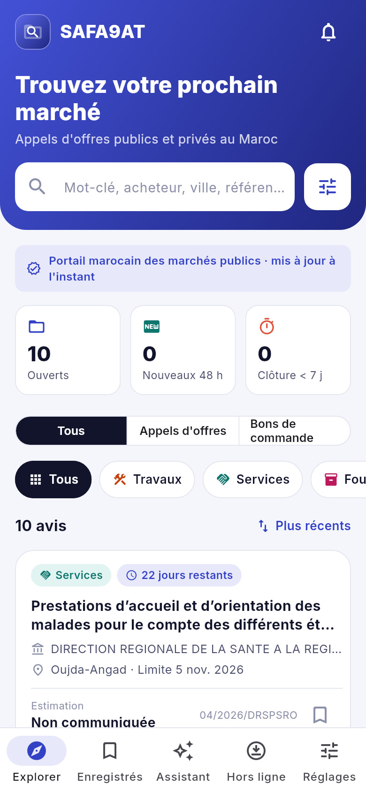

# Mounaqasa — appels d'offres au Maroc

Application Flutter qui reprend les **fonctionnalités** de « Safaqat : Marchés publics »
(Google Play `app.safaqat`) avec un **design entièrement différent**. Elle permet de consulter
les appels d'offres publics et privés au Maroc.

> Le nom « Mounaqasa / مناقصة » est provisoire et se change à un seul endroit :
> `lib/core/config.dart`. Le nom, le logo et les textes doivent rester distincts de
> l'app d'origine.

**Stack** : Flutter 3.47 / Dart 3.13 · `intl` · `shared_preferences` · `http` · `url_launcher` · `firebase_messaging`.

## Captures

| Accueil | Fiche | Filtres | Assistant | Arabe |
|---|---|---|---|---|
|  |  |  |  |  |

Toutes les captures sont dans `captures/`. Pour les régénérer :
`flutter test --update-goldens tool/captures_test.dart`

## Fonctionnalités reprises

| Safaqat | Ici |
|---|---|
| Consultation des appels d'offres publics et privés | Onglet **Explorer** : liste des avis ouverts, compteurs (ouverts, nouveaux 48 h, clôture sous 7 j) |
| Recherche par mots-clés | Barre de recherche : objet, acheteur, ville, référence, accents ignorés |
| Filtres avancés | Écran **Filtres** : catégorie, secteur privé, date limite, publication, montant, procédure, région, avec le nombre de résultats en direct |
| Télécharger les consultations en un clic | Bouton du bas de la fiche : avis officiel sur le portail (exemples : téléchargement simulé) |
| Toujours disponibles (hors ligne) | Dernière liste gardée sur le téléphone ; onglet **Hors ligne** pour les dossiers (mode exemples) |
| Notifications selon vos préférences | Écran **Alertes** : nouveaux avis, rappels de date limite (1, 3 ou 7 j), catégories, mots-clés, régions. Notifications push envoyées par le serveur chaque matin |
| AI Summaries | **Résumé IA** sur chaque fiche (Claude, via le serveur) en français et en arabe ; résumé automatique de l'app en mode exemples ou si l'IA est indisponible |
| AI Assistant | Onglet **Assistant** : recherche en langage courant (« travaux à Marrakech », « fournitures de plus de 5 millions »…) |
| — | En plus : avis **enregistrés**, interface **français / arabe** (RTL) |

## Design

Un thème clair, vert émeraude et corail, à l'opposé de l'app d'origine (fond anthracite,
accents jaunes). L'accueil a un en-tête en dégradé avec la recherche intégrée. Les cartes
sont arrondies et colorées par catégorie (Travaux en orange, Services en bleu, Fournitures en
violet). L'échéance s'affiche en vert, puis ambre sous 7 jours et corail sous 3 jours. La
barre du bas compte cinq onglets. Les couleurs sont regroupées dans `lib/theme/theme.dart`.

## Données : exemples ou vrais avis

L'app a deux modes, choisis à la compilation :

- **Sans `API_URL`** : 18 avis d'exemple (références `DEMO-…`), signalés par un bandeau.
  Pratique pour montrer l'app ou travailler sur le design.
- **Avec `API_URL`** : les vrais avis ouverts, collectés sur le portail marocain des
  marchés publics par le serveur `tenders_api/` (voir son README). Le bandeau indique la
  source et l'heure de mise à jour. La dernière liste reçue est gardée sur le
  téléphone : sans réseau, l'app l'affiche avec un bandeau « Hors connexion ».
  Le bouton du bas de chaque fiche ouvre l'**avis officiel** sur le portail, où se
  télécharge le dossier de consultation.

```bash
flutter run --dart-define=API_URL=https://api.exemple.ma
```

| Exemples | Vrais avis |
|---|---|
|  |  |

## Notifications

Quand l'utilisateur enregistre ses alertes, l'app demande l'autorisation d'afficher des
notifications, puis inscrit le téléphone auprès du serveur (`tenders_api`). Elle met
ensuite l'inscription à jour à chaque changement d'alertes, d'avis enregistrés ou de
langue. Chaque matin vers 8 h 30, le serveur envoie :

- une notification pour les **nouveaux avis** qui correspondent aux alertes ;
- un **rappel** avant la date limite des avis enregistrés.

Toucher une notification ouvre la fiche de l'avis, ou la liste pour une alerte groupée.
Si une notification arrive pendant que l'app est ouverte, un bandeau « Voir » s'affiche.
L'écran **Alertes** indique où en sont les notifications : actives, à autoriser,
bloquées dans les réglages, ou serveur injoignable.

Sans configuration Firebase, l'app se construit et fonctionne normalement, simplement
sans notifications. Les notifications sont aussi désactivées en mode exemples.

### Configuration Firebase (une seule fois)

1. Sur la [console Firebase](https://console.firebase.google.com/), créez un projet
   (le même que pour le serveur).
2. **Android** : ajoutez une app Android avec l'identifiant `ma.mounaqasa.mounaqasa`.
   Téléchargez `google-services.json` et placez-le dans `android/app/`. Le plugin Google
   Services s'applique alors automatiquement.
3. **iOS** :
   - ajoutez une app iOS avec le même identifiant, téléchargez
     `GoogleService-Info.plist` et ajoutez-le à la cible *Runner* dans Xcode (glisser
     dans le dossier Runner, cocher *Copy items if needed*) ;
   - dans le portail Apple Developer, créez une clé APNs (*Keys → +*, cochez *Apple
     Push Notifications service*), puis importez-la dans Firebase (*Paramètres du projet
     → Cloud Messaging → Configuration des applications Apple*) ;
   - dans Xcode, cible *Runner → Signing & Capabilities*, vérifiez que *Push
     Notifications* apparaît. Le fichier `Runner.entitlements` et le mode
     arrière-plan *remote-notification* sont déjà en place.
4. Ces deux fichiers ne sont pas versionnés (`.gitignore`) : ils sont propres à chaque
   projet Firebase.

## Ce qui reste à faire

1. **Mettre le serveur en ligne** (`tenders_api/`) et lancer une première collecte réelle.
   Le serveur n'a jamais tourné contre le portail réel : il a été validé sur des pages
   réelles enregistrées.
2. **Créer le projet Firebase** et faire un premier essai de notifications sur de vrais
   téléphones. L'envoi a été testé contre un faux service Google, et l'app n'a pas pu
   être compilée pour Android ou iOS dans l'environnement de développement (seulement
   pour le web).
3. **L'assistant** comprend encore les demandes par mots-clés, sans connexion. Les
   résumés IA passent déjà par le serveur (clé d'API Anthropic côté serveur). Un
   assistant conversationnel et la lecture du CPS pourraient suivre le même chemin.
4. **Les consultations privées** : le portail ne publie que les marchés publics.
5. **Publication** : icône de l'app (le logo actuel est dessiné en Flutter, l'icône du
   lanceur est encore celle de Flutter), identifiant définitif (`ma.mounaqasa.mounaqasa`
   aujourd'hui), signature et fiches App Store / Play Store.

## Lancer

```bash
flutter pub get
flutter run                 # téléphone ou émulateur branché
flutter run -d chrome       # aperçu dans le navigateur
flutter test                # 68 tests : logique, API, notifications, résumés IA, chaque écran en FR et AR
flutter build apk --release --dart-define=API_URL=https://api.exemple.ma
flutter build ipa           # sur macOS avec Xcode
```

## Organisation

| Dossier | Rôle |
|---|---|
| `lib/core/` | nom de l'app, mode démonstration |
| `lib/data/` | source des avis, avis de démonstration, assistant de recherche |
| `lib/models/` | avis, filtres, préférences d'alertes |
| `lib/ai/` | résumés IA lus sur l'API |
| `lib/push/` | notifications du téléphone (Firebase) et inscription auprès du serveur |
| `lib/state/` | état partagé (`AppState`) et sa diffusion dans l'arbre (`AppScope`) |
| `lib/screens/` | un fichier par écran |
| `lib/widgets/` | carte d'avis, pastilles, boutons, panneaux |
| `lib/i18n/` | traduction FR/AR, formats de date, de montant et de taille |
| `lib/theme/` | couleurs, rayons, thème Material |
| `test/` | tests de logique et d'écrans |
| `tool/` | génération des captures |
