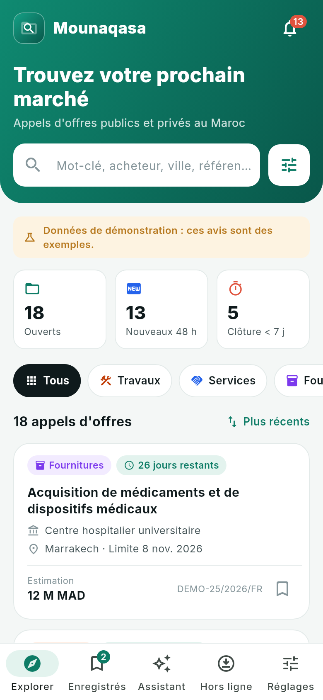
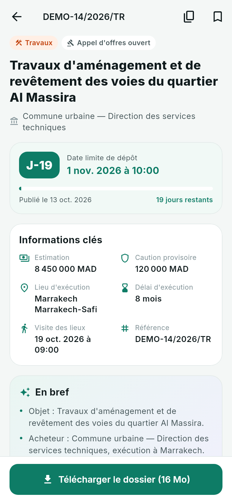
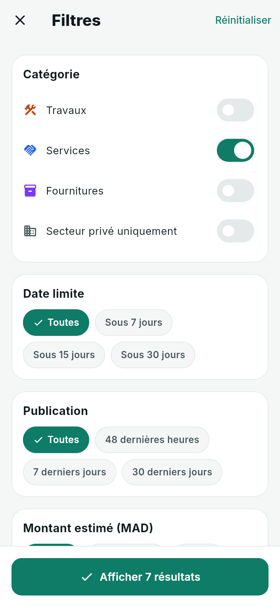
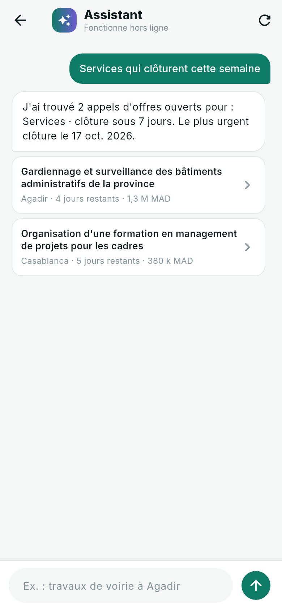
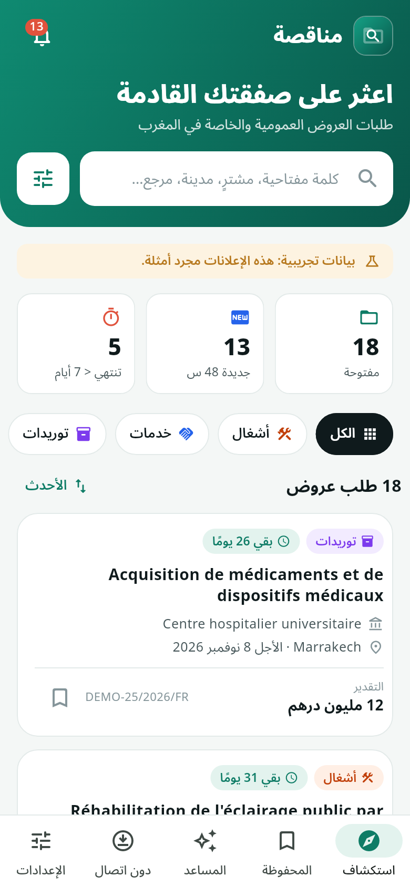

# Mounaqasa — appels d'offres au Maroc

Application Flutter qui reprend les **fonctionnalités** de « Safaqat : Marchés publics »
(Google Play `app.safaqat`) avec un **design entièrement différent**. Elle permet de consulter
les appels d'offres publics et privés au Maroc.

> Le nom « Mounaqasa / مناقصة » est provisoire et se change à un seul endroit :
> `lib/core/config.dart`. Le nom, le logo et les textes doivent rester distincts de
> l'app d'origine.

**Stack** : Flutter 3.47 / Dart 3.13 · `intl` · `shared_preferences`. Pas d'autre dépendance.

## Captures

| Accueil | Fiche | Filtres | Assistant | Arabe |
|---|---|---|---|---|
|  |  |  |  |  |

Toutes les captures sont dans `captures/`. Pour les régénérer :
`flutter test --update-goldens tool/captures_test.dart`

## Fonctionnalités reprises

| Safaqat | Ici |
|---|---|
| Consultation des appels d'offres publics et privés | Onglet **Explorer** : liste des avis ouverts, compteurs (ouverts, nouveaux 48 h, clôture sous 7 j) |
| Recherche par mots-clés | Barre de recherche : objet, acheteur, ville, référence, accents ignorés |
| Filtres avancés | Écran **Filtres** : catégorie, secteur privé, date limite, publication, montant, procédure, région, avec le nombre de résultats en direct |
| Télécharger les consultations en un clic | Bouton **Télécharger le dossier** sur la fiche |
| Toujours disponibles (hors ligne) | Onglet **Hors ligne** : dossiers téléchargés, espace utilisé, suppression |
| Notifications selon vos préférences | Écran **Alertes** : nouveaux avis, rappels de date limite (1, 3 ou 7 j), catégories, mots-clés, régions |
| AI Summaries | Bloc **En bref** sur chaque fiche |
| AI Assistant | Onglet **Assistant** : recherche en langage courant (« travaux à Marrakech », « fournitures de plus de 5 millions »…) |
| — | En plus : avis **enregistrés**, interface **français / arabe** (RTL) |

## Design

Un thème clair, vert émeraude et corail, à l'opposé de l'app d'origine (fond anthracite,
accents jaunes). L'accueil a un en-tête en dégradé avec la recherche intégrée. Les cartes
sont arrondies et colorées par catégorie (Travaux en orange, Services en bleu, Fournitures en
violet). L'échéance s'affiche en vert, puis ambre sous 7 jours et corail sous 3 jours. La
barre du bas compte cinq onglets. Les couleurs sont regroupées dans `lib/theme/theme.dart`.

## Ce qui reste à brancher

L'app fonctionne entièrement avec **18 avis de démonstration** (références `DEMO-…`,
signalés par un bandeau). Pour une mise en production, il manque :

1. **Un serveur qui collecte les avis** depuis le portail marocain des marchés publics (et
   les sources privées) et les expose en API. Côté app, il suffit d'écrire une autre
   implémentation de `TenderRepository` (`lib/data/tender_repository.dart`), puis de passer
   `AppConfig.demoData` à `false`.
2. **Le vrai téléchargement des pièces** : `AppState.download` simule aujourd'hui le
   transfert. Il faudra écrire les fichiers reçus du serveur dans le stockage de l'app
   (paquet `path_provider`) et les ouvrir (`open_filex` ou équivalent).
3. **Les notifications push** : les préférences sont enregistrées, mais l'envoi demande le
   serveur et Firebase Cloud Messaging / APNs.
4. **L'IA** : le résumé est construit à partir des champs de l'avis, et l'assistant
   comprend les demandes par mots-clés, sans connexion. Un vrai modèle de langage
   (lecture du CPS, réponses libres) doit passer par le serveur, car la clé d'API ne peut
   pas être embarquée dans l'app.
5. **Publication** : icône de l'app (le logo actuel est dessiné en Flutter, l'icône du
   lanceur est encore celle de Flutter), identifiant définitif (`ma.mounaqasa.mounaqasa`
   aujourd'hui), signature et fiches App Store / Play Store.

## Lancer

```bash
flutter pub get
flutter run                 # téléphone ou émulateur branché
flutter run -d chrome       # aperçu dans le navigateur
flutter test                # 44 tests : logique + chaque écran en FR et AR, grand et petit téléphone
flutter build apk --release
flutter build ipa           # sur macOS avec Xcode
```

## Organisation

| Dossier | Rôle |
|---|---|
| `lib/core/` | nom de l'app, mode démonstration |
| `lib/data/` | source des avis, avis de démonstration, assistant de recherche |
| `lib/models/` | avis, filtres, préférences d'alertes |
| `lib/state/` | état partagé (`AppState`) et sa diffusion dans l'arbre (`AppScope`) |
| `lib/screens/` | un fichier par écran |
| `lib/widgets/` | carte d'avis, pastilles, boutons, panneaux |
| `lib/i18n/` | traduction FR/AR, formats de date, de montant et de taille |
| `lib/theme/` | couleurs, rayons, thème Material |
| `test/` | tests de logique et d'écrans |
| `tool/` | génération des captures |
